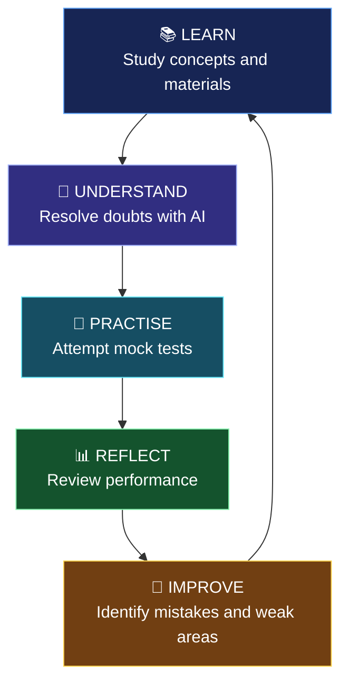
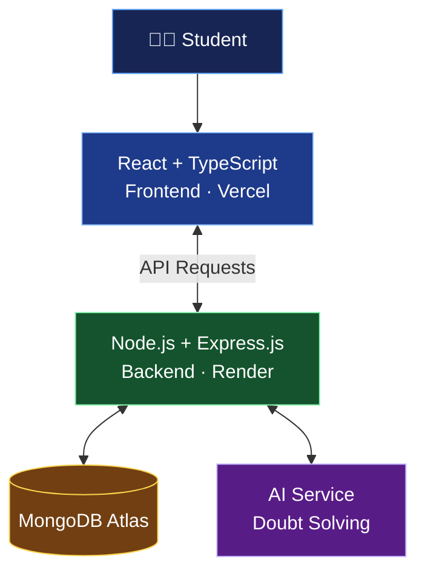

<div align="center">

# 🚀 PrepZen

### Don't Just Prepare for JEE. Learn How to Win It.

**One platform. Smarter preparation. A better way to learn from every mistake.**

What if every doubt you asked, every test you attempted, and every mistake you made could help you decide what to do next?

That's the idea behind PrepZen.

<br/>

### 🎯 YOUR NEXT STEP TOWARDS JEE, ALL IN ONE PLACE.

**[⚡ EXPLORE PREPZEN](https://prep-zen-kohl.vercel.app/)**

*Built for the students chasing a dream, one question at a time.*

</div>

---

## 💭 The Story Behind PrepZen

Imagine a student preparing for JEE.

They spend hours studying Physics. They get stuck on a difficult question and open another platform to understand it. Later, they attempt a mock test, score less than expected, and realise they made mistakes in topics they thought they understood.

Now comes the difficult part.

**What should they study next? Why did they lose those marks? Which mistakes should they stop repeating?**

The student has study materials. They have questions to practise. They even have tools to clear their doubts.

But connecting all these pieces into a consistent preparation strategy is still a challenge.

And when you're preparing for one of the most competitive examinations in the country, every hour matters.

I started building **PrepZen** around a simple thought:

> What if students didn't have to manage their preparation across disconnected tools? What if studying, clearing doubts, practising, and learning from mistakes could happen in one connected experience?

That question became PrepZen.

## 🌟 Meet PrepZen

PrepZen is an AI-powered JEE preparation platform designed to bring essential parts of the learning journey together.

It's not just about giving students another place to read notes or attempt questions.

**It's about making the time they spend preparing more meaningful.**

With PrepZen, students can access study materials, resolve academic doubts using AI, attempt mock tests, and work towards understanding their performance and mistakes.

The current version is an MVP: a working foundation for a much bigger vision.

---

## 🔥 What Can You Do With PrepZen?

### 🤖 01 — Get Unstuck. Keep Learning.

**AI-Powered Doubt Solver**

Every student eventually reaches a question that stops their progress.

Instead of abandoning the problem or spending too long searching for an explanation, students can ask PrepZen for AI-generated help.

The goal is simple: reduce interruptions and help students return to learning with a clearer understanding.

### 📚 02 — Bring Your Preparation Together.

**Centralised Study Materials**

Your preparation shouldn't feel like a collection of browser tabs.

PrepZen provides a central place to access JEE study resources, helping students keep their learning materials organised and accessible.

Less time switching between resources. More time spent learning.

### 📝 03 — Put Your Understanding to the Test.

**Mock Tests**

Reading a concept and solving a question under exam conditions are two different things.

Mock tests give students an opportunity to practise, evaluate their preparation, and discover where their understanding needs improvement.

Because confidence should come from practice, not just from finishing a chapter.

### 📊 04 — Look Beyond the Score.

**Performance Analysis**

A score tells you what happened in a test. Understanding your performance helps you decide what to do next.

PrepZen's broader approach is to help students review their results, recognise weak areas, and use performance insights to guide future practice.

The objective isn't merely to attempt more tests. It's to learn more from every test.

### 🧠 05 — Turn Mistakes Into Lessons.

**Mistake Analysis**

Getting a question wrong doesn't always mean you don't understand the concept.

Sometimes, the problem is conceptual. Sometimes, it's a calculation error or a moment of carelessness. Sometimes, it's a guess that didn't work out.

Recognising these differences can help students approach revision more deliberately.

PrepZen is built around the idea that mistakes shouldn't simply be counted and forgotten. They should become opportunities to improve.

### 🔐 06 — The Right Access for the Right Users.

**Authentication and Role-Based Access**

A preparation platform needs more than a good interface. It also needs to manage who can access which parts of the application.

PrepZen includes authentication and role-based access control to support permissions based on user roles.

This provides a foundation for a platform that can grow to support more users and capabilities.

---

## 🔄 The PrepZen Learning Loop

<div align="center">

### Every question is an opportunity. Every test is feedback.

</div>



This is the central idea behind PrepZen.

Preparation shouldn't end when a student finishes a chapter or submits a test. Each activity should help them make a better decision about what to learn or practise next.

**Learn → Understand → Practise → Reflect → Improve.**

That's the experience we're working towards.

---

## 🏗️ Under the Hood: How PrepZen Is Built

PrepZen uses a separate frontend and backend, with a cloud-hosted database and an AI service.



### A look at the project structure

The repository separates the frontend from the backend to keep the application modular and easier to maintain.

```text
jee-compass/
│
├── client/                 # React frontend
│   ├── src/
│   │   ├── services/       # API communication
│   │   ├── components/     # Reusable interface elements
│   │   ├── pages/          # Application screens
│   │   └── ...
│   ├── public/             # Static assets
│   └── package.json
│
├── server/                 # Express backend
│   ├── index.js            # Server entry point
│   ├── ...                 # API and application logic
│   └── package.json
│
└── README.md
```

*This is a high-level illustration; adjust the tree to match the actual repository.*

### Technology Stack

| Technology    | Why it's used                             |
| ------------- | ----------------------------------------- |
| React         | Building the user interface               |
| TypeScript    | Making frontend development more reliable |
| Vite          | Fast development and production builds    |
| Tailwind CSS  | Styling the interface                     |
| Node.js       | Running the backend                       |
| Express.js    | Handling API requests and server logic    |
| MongoDB Atlas | Cloud database                            |
| AI API        | Generating responses to academic doubts   |
| Vercel        | Hosting the frontend                      |
| Render        | Hosting the backend                       |

### Why this architecture?

The frontend and backend can be developed and deployed independently. The backend acts as the central point for application logic and communication with the database and AI service.

This separation gives PrepZen a foundation that can evolve as new features are added.

---

## 🎯 The MVP: What We've Built So Far

Every ambitious product starts somewhere.

For PrepZen, the MVP focuses on establishing the core preparation experience rather than attempting to solve every challenge faced by JEE aspirants at once.

| Area           | MVP Focus                                 |
| -------------- | ----------------------------------------- |
| Student access | Authentication and role-based permissions |
| Learning       | Access to study materials                 |
| Doubt solving  | AI-assisted academic responses            |
| Practice       | Mock-test experience                      |
| Improvement    | Reviewing performance and mistakes        |
| Infrastructure | Deployed frontend, backend, and database  |

The MVP is the starting point, not the finish line.

The next challenge is to make the learning experience more connected, more personalised, and more useful to each student.

*Feature descriptions should reflect what is actually working in the deployed application.*

---

## 🚀 What's Next for PrepZen?

The long-term vision is to move from a platform that brings preparation tools together towards an experience that helps students decide how to prepare.

Some directions I'd like to explore include:

**🎯 Personalised Study Plans**
Help students decide what to revise based on their preparation and performance.

**🧩 Adaptive Practice**
Recommend questions that target specific learning gaps.

**📈 Deeper Performance Insights**
Help students recognise recurring mistakes and understand changes in their performance over time.

**🗓️ Smarter Revision**
Help students prioritise topics and organise revision more effectively.

**📚 A Growing Question Bank**
Build a larger collection of quality JEE practice questions and learning resources.

These are future directions, not claims about functionality already available in the MVP.

The larger goal is to make preparation less about doing everything and more about doing the right things consistently.

---

## 🚀 What's Next? The Future of PrepZen

**The MVP is just the beginning. The bigger vision is to make JEE preparation more personalised, more insightful, and more accessible to every aspirant.**

Today, PrepZen brings essential preparation tools together. Tomorrow, I want it to help students understand not just what they are studying, but what they should focus on next—and why.

Here's what I'd love to build next.

### 🧠 01. An AI Mentor That Understands Your Preparation

Imagine having a study companion that helps you work through doubts and guides your learning journey.

The next step for PrepZen is a more personalised AI mentor that can help students understand difficult concepts, revisit prerequisite topics, and approach problems step by step.

The goal isn't to replace teachers. It's to give students another way to get help when they need it.

### 🎯 02. Personalised Study Plans

Every student has different strengths, weaknesses, and preparation timelines.

PrepZen could use test performance, topic-level accuracy, and revision history to recommend what a student should work on next.

Instead of following the same plan as everyone else, students could receive recommendations tailored to their individual learning needs.

### 📊 03. Smarter Mistake Analysis

A wrong answer is more than a lost mark.

Future versions could analyse recurring mistakes and help students distinguish between conceptual gaps, calculation errors, careless mistakes, and gaps in problem-solving strategy.

Over time, these insights could help students recognise patterns in their preparation and focus on the areas that need the most attention.

### 🔁 04. Adaptive Practice Engine

What if the questions you practised next were chosen based on what you struggled with previously?

An adaptive practice engine could recommend questions based on topic mastery, previous mistakes, difficulty level, and performance history.

The aim would be to make practice more targeted rather than simply increasing the number of questions attempted.

### 🗓️ 05. Intelligent Revision Planner

Students often forget to revisit concepts they studied weeks ago.

A future revision planner could schedule revision sessions based on topic importance, previous performance, and how long it has been since a topic was last reviewed.

The idea is to help students balance learning new material with retaining what they already know.

### 📝 06. A More Complete JEE Test Experience

PrepZen aims to develop a richer test-taking experience inspired by the JEE examination format.

Potential improvements include:

* A larger, well-organised question bank.
* More full-length mock tests.
* Chapter-wise and subject-wise practice.
* Difficulty-based question selection.
* Detailed post-test explanations.
* Better performance comparisons across attempts.

The focus would be on helping students prepare under realistic conditions and learn from every attempt.

### 🌱 07. Accessible Preparation for Everyone

High-quality preparation resources shouldn't be out of reach simply because a student cannot afford another subscription.

My long-term vision is to keep PrepZen's core learning resources accessible and explore ways to grow the platform through community participation, educational partnerships, and collaborations.

The priority is to build something students genuinely find useful.

---

### 🔭 The Bigger Picture

I don't want PrepZen to be just another website where students read notes, ask questions, and take tests.

**I want to build a platform that helps students make better decisions about their preparation.**

A platform that helps them recognise what they understand, identify what they don't, and decide what to do next.

The journey starts with the MVP. The next step is learning from real students, understanding their challenges, and building features that genuinely help them improve.

*These are planned directions for future development, not features currently available in the MVP.*


## 💻 Run PrepZen Locally

Want to explore the project or build on it? Here's how to get started.

### Requirements

* Node.js and npm
* A MongoDB database
* Credentials for the AI service used by the backend

### 1. Clone the repository

```bash
git clone https://github.com/khushhalkumrawat/jee-compass.git
cd jee-compass
```

### 2. Start the backend

```bash
cd server
npm install
```

Create `server/.env` and configure the variables required by your backend. For example:

```env
PORT=5000
MONGODB_URI=your_mongodb_connection_string
FRONTEND_URL=http://localhost:5173
```

Configure the AI credentials using the exact variable names expected by your code.

Start the backend using the script in `server/package.json`. If the project defines a `dev` script:

```bash
npm run dev
```

### 3. Start the frontend

Open another terminal:

```bash
cd client
npm install
```

Create `client/.env`:

```env
VITE_API_URL=http://localhost:5000
```

Run:

```bash
npm run dev
```

Open the local URL displayed by Vite, usually `http://localhost:5173`.

*If your npm scripts differ, use the commands defined in your project's `package.json` files.*

### 🔒 Keep your credentials safe

Never commit API keys, database credentials, or secret environment variables to GitHub. Configure production variables in the relevant deployment dashboards.

---

## 🌐 Try It Yourself

<div align="center">

### Your next study session could start here.

**[🚀 OPEN PREPZEN](https://prep-zen-kohl.vercel.app/)**

Explore the platform and experience the idea for yourself.

</div>

---

## 👨‍💻 A Little About the Builder

Hi, I'm **Khushhal Kumrawat**, an IIT (BHU) student interested in software development, AI, and building products that solve practical problems.

I built PrepZen as a way to explore how full-stack development and AI could come together to address a problem familiar to many students: making preparation more organised and learning from mistakes more effectively.

This project is an early step towards that idea.

There's still plenty to improve, but the direction is clear: build something useful, test it with real students, learn from their feedback, and make it better.

### Let's Connect

* 📧 **Email:** [khushhalkumrawat@gmail.com](mailto:khushhalkumrawat@gmail.com)
* 💼 **LinkedIn:** [Connect with me](https://www.linkedin.com/in/khushhalkumrawat-017bb6390/)
* 💻 **GitHub:** [Explore my projects](https://github.com/khushhalkumrawat)

---

<div align="center">

# PrepZen 🚀

### Study with purpose. Practise with intent. Improve with every attempt.

**Built with curiosity, code, and a belief that preparation can be better.**

[Launch PrepZen](https://prep-zen-kohl.vercel.app/)

</div>
